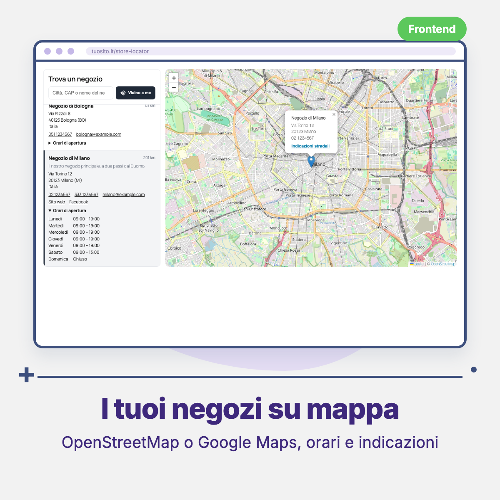
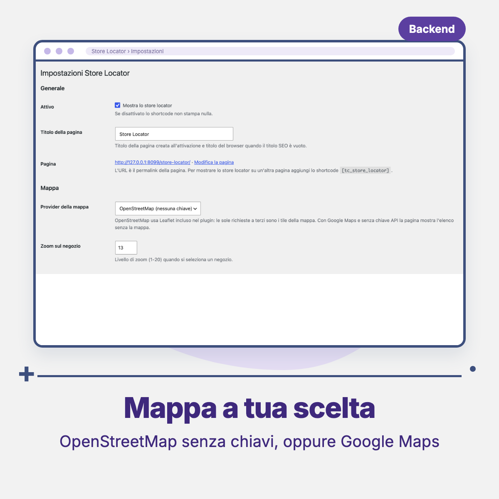

# Threecommerce Store Locator: store locator for WordPress and WooCommerce

A **store locator** page for WordPress and WooCommerce: a list of your stores with an **OpenStreetMap** or **Google Maps** map (your choice, from the admin), search by city or postcode, "near me" and opening hours. Stores are managed from the WordPress admin. It is the WordPress port of our Magento 2 store locator.

**Compatibility:** WordPress 6.0+ (tested on 7.1) · PHP 8.1 – 8.4 · Works with or without WooCommerce
**License:** commercial · coming soon

## Features

- **Stores in the admin**: a *Store Locator → Stores* menu (custom post type) with name, active flag, sort order, description, address, country, **latitude/longitude**, two phone numbers, email, website, Facebook, X/Twitter and **opening hours** for each day. Mass actions to activate or deactivate stores.
- **Map provider** chosen from the settings: **OpenStreetMap** (default, no key and no account; Leaflet 1.9.4 is bundled in the plugin, no CDN) or **Google Maps** (API key and optional Map ID).
- **Front end**: server-rendered list with only the active stores, sorted by sort order and name. The map loads only when it scrolls into view; a click on a store or marker centers the map and opens an info window with name, address, phone and a "Get directions" link.
- **Search** by city, postcode, address or name filters list and map. **Near me** sorts the stores by distance, computed in the browser (needs the location permission).
- Shortcode `[tc_store_locator]` and a page created on activation.
- Vanilla JavaScript (no jQuery) and plain CSS with `--tc-storelocator-*` variables, so it fits any theme.
- Settings: enable, page title, map provider, Google key and Map ID, zoom (1-20), content before and after the map, meta title, description and keywords, optional data removal on uninstall.
- Public API (`Stores`, `MapConfig`, the `wo_sl_store_fields` filter and the `wo_sl_loaded` action) that other plugins can use. Italian translation included.

## Requirements

- WordPress 6.0 or newer
- PHP 8.1 – 8.4
- WooCommerce is **not** required
- With OpenStreetMap nothing else is needed. With Google Maps you need an API key with the *Maps JavaScript API* enabled; without a key the page still shows the store list

## Tested with

WordPress 7.1 (with WooCommerce 10.9.4 installed). Google Maps with a real API key has **not** been tested yet: check that your key works on your site.

## Availability

This plugin is **not yet available for purchase**. See the [product page](https://www.threecommerce.it/store-locator-woocommerce?utm_source=github&utm_medium=readme&utm_campaign=woocommerce-store-locator) for its status, or [get in touch](https://www.threecommerce.it/contatti?utm_source=github&utm_medium=readme&utm_campaign=woocommerce-store-locator) to be notified at launch or to ask for information.

## Configuration

WordPress admin → **Store Locator → Settings**: enable, page title, map provider (OpenStreetMap or Google Maps), Google API key and Map ID, zoom, content before and after the map, SEO. Stores are managed in **Store Locator → Stores**. To show the locator on another page use the `[tc_store_locator]` shortcode.

## Documentation and support

- Product page: [threecommerce.it/store-locator-woocommerce](https://www.threecommerce.it/store-locator-woocommerce?utm_source=github&utm_medium=readme&utm_campaign=woocommerce-store-locator)
- [Changelog](CHANGELOG.md) (in Italian)
- Support and custom development: [threecommerce.it/contatti](https://www.threecommerce.it/contatti?utm_source=github&utm_medium=readme&utm_campaign=woocommerce-store-locator)

---

*This repository is the public showcase of the plugin. The source code is kept in a private repository.*
